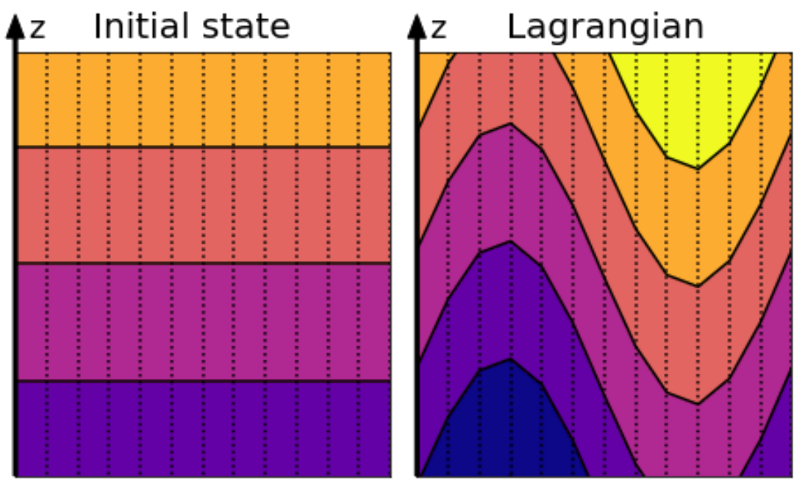
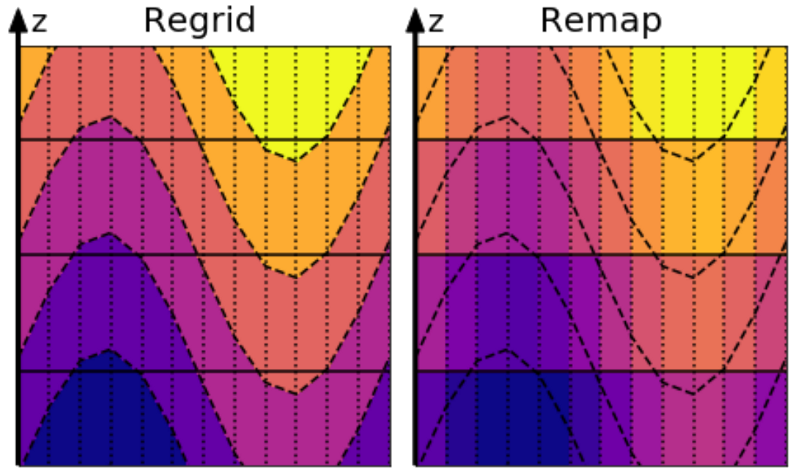
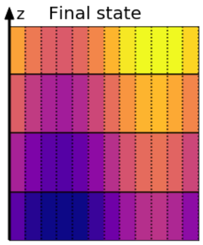

.. _ALE_Timestep:

Vertical Lagrangian method in pictures
======================================

.. _section_ALE_remap:

Graphical explanation of vertical Lagrangian method
---------------------------------------------------

Vertical Lagrangian regridding/remapping is not a timestep method in the traditional sense. Rather, it is a sequence of operations performed to bring the vertical grid back to a target specification (the regrid step), and then to remap the ocean state onto this new grid (the remap step). This regrid/remap process can be chosen to be less frequent than the momentum or thermodynamic timesteps. We are motivated to choose less frequent regrid/remap steps to save computational time and to reduce spurious mixing that occurs due to truncation errors in the remap step. However, there is a downside to delaying the regrid/remap. Namely, if delayed too long then the layer interfaces can become entangled (i.e., no longer monotonic in the vertical), which is a common problem with purely Lagrangian methods. On this page we illustrate the regrid/remap steps by making use of Figure 3 from Griffies, Adcroft, and Hallberg (2020) :cite:`Griffies_Adcroft_Hallberg2020`.

For purposes of this example, assume that the target vertical grid is comprised of geopotential :math:`z`-surfaces, with the initial ocean state (e.g., the temperature field) shown on the left in the following figure.

   Initial state with level surface (left) and perturbed state after a wave has come through (right)

Some time later, assume a wave has perturbed the ocean state. During the Lagrangian portion of the algorithm, the coordinate surfaces move vertically with the ocean fluid according to :math:`\dot{r}=0`. Assume now that the algorithm has determined that a regrid step is needed, with the target vertical grid still geopotential :math:`z`-surfaces, so this new target grid is shown overlaid on the left as a regrid.

   The regrid operation (left) and the remap operation (right)

The most complex part of the method involves remapping the wavy ocean field onto the new grid. This step also incurs truncation errors that are a function of the vertical grid spacing and the numerical method used to perform the remapping. We illustrate this remap step in the figure above, as well as in the frame below shown after the old deformed coordinate grid has been deleted:

   The final state after regriddinig and remapping

The new layer thicknesses, :math:`h_k`, are computed and then the layers are populated with the new velocities and tracers

.. math::

   \begin{aligned}
   \sum h_k^{\scriptstyle{\mathrm{new}}} &= \sum h_k^{\scriptstyle{\mathrm{old}}}
   \\
     \mathbf{u}_k^{\scriptstyle{\mathrm{new}}}
     &= \frac{1}{h_k}
     \int_{z_{k + 1/2}}^{z_{k + 1/2} + h_k} \mathbf{u}^{\scriptstyle{\mathrm{old}}}(z') \, \mathrm{d}z'
   \\
     \theta_k^{\scriptstyle{\mathrm{new}}}  &= \frac{1}{h_k}
     \int_{z_{k + 1/2}}^{z_{k + 1/2} + h_k} \theta^{\scriptstyle{\mathrm{old}}}(z') \, \mathrm{d}z'
   \end{aligned}
