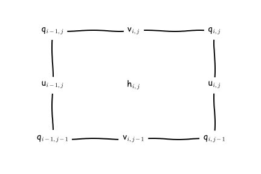
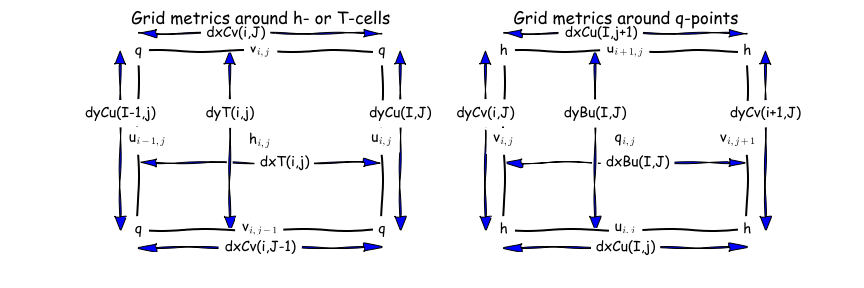

.. _Discrete_Grids:

Discrete Horizontal and Vertical Grids
======================================

.. _horizontal_grids:

Horizontal grids
----------------

The placement of model variables on the horizontal C-grid is illustrated here:

   MOM6 uses an Arakawa C grid staggering of variables with a North-East indexing convention.

Scalars are located at the :math:`h`-points, velocities are staggered such that :math:`u`-points and :math:`v`-points are not co-located, and vorticities are located at :math:`q`-points. The indexing for points (:math:`i,j`) in the logically-rectangular domain is such that :math:`i` increases in the :math:`x` direction (eastward for spherical polar coordinates), and :math:`j` increases in the :math:`y` direction (northward for spherical polar coordinates). A :math:`q`-point with indices (:math:`i,j`) lies to the upper right (northeast) of the :math:`h`-point with the same indices. The index for the vertical dimension :math:`k` increases with depth, although the vertical coordinate :math:`z`, measured from the mean surface level :math:`z = 0`, decreases with depth.

When the horizontal grid is generated, it is actually computed on the "supergrid" at twice the nominal resolution of the model. The grid file contains the grid metrics and the areas of this fine grid. The model then decomposes it into the four staggered grids, along with computing the grid metrics as shown here:

   The grid metrics around both :math:`h`-points and :math:`q`-points.

The model carries both the metrics as well as their inverses, for instance, IdyT = 1/dyT. There are also the areas and the inverse areas for all four grid locations. areaT and areaBu are the sum of the four areas from the supergrid surrounding each h-point and each q-point, respectively. The velocity faces can be partially blocked and their areas are adjusted accordingly, where :math:`dy\_Cu` and :math:`dx\_Cv` are the blocked distances at :math:`u` and :math:`v` points, respectively.

.. math::

   \begin{aligned}
   \mbox{areaCu}_{i,j} &= dxCu_{i,j} * dy\_Cu_{i,j} \\
   \mbox{areaCv}_{i,j} &= dx\_Cv_{i,j} * dyCv_{i,j} \\
   \mbox{IareaCu}_{i,j} &= 1 / \mbox{areaCu}_{i,j} \\
   \mbox{IareaCv}_{i,j} &= 1 / \mbox{areaCv}_{i,j}
   \end{aligned}

The horizontal grids can be spherical, tripole, regional, or cubed sphere. The default is for grids to be re-entrant in the :math:`x`-direction; this needs to be turned off for regional grids.

.. _section_vertical_grids:

Vertical grids
--------------

The placement of model variables in the vertical is illustrated here:

   The MOM6 interfaces are at vertical location :math:`e` which are separated by the layer thicknesses :math:`h`.

The vertical coordinate is Lagrangian in that the interfaces between the layers are free to move up and down with time. The interfaces have target depths or target densities, depending on the desired vertical coordinate system. They can even have target sigma values for terrain-following coordinates or you can design a hybrid coordinate in which different interfaces have differing behavior. In any case, the interfaces move with the fluid during the dynamic timesteps and then get reset during a remapping operation. See section `Vertical Lagrangian method in pictures <ALE_Timestep.html#ale-timestep>`__ for details.
