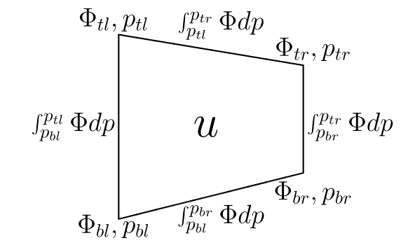

.. _Discrete_PG:

Discrete Pressure Gradient Term
===============================

.. _section_PG:

Pressure Gradient Term
----------------------

Following :cite:`adcroft2008`, the horizontal momentum equation in the general coordinate :math:`r` can be written as:

.. math::

   \frac{\partial \vec{u}}{\partial t} + \nabla_r \Phi + \alpha \nabla_r p = \cal{F}

where the vector :math:`\cal{F}` represents all the forcing terms other than the pressure gradient. Here, :math:`\vec{u}` is the horizontal component of the velocity, :math:`\Phi` is the geopotential:

.. math::

   \Phi = gz

:math:`\alpha = 1/\rho` is the specific volume and :math:`p` is the pressure. The gradient operator is a gradient along the coordinate surface :math:`r`.

MOM6 offers two options, an older one using a Montgomery potential as described in :cite:`hallberg1997` and :cite:`sun1999`. However, it can have the instability described in :cite:`hallberg2005`. The version described here is that in :cite:`adcroft2008` and is the recommended option (ANALYTIC_FV_PGF = True). The paper describes the Boussinesq form while the code supports that and also a non-Boussinesq form.

In two dimensions (:math:`x` and :math:`p`), we can integrate the zonal component of the momentum equation above over a finite volume:

.. _eq:PG_loop:

.. math::

   \begin{aligned}
      - \int dx \int dp \frac{\partial u}{\partial t} &= \int dx \int dp \left. \frac{\partial
      \Phi}{\partial x}\right|_p \\
      &= \int_{p_{br}}^{p_{tr}} \Phi dp + \int_{p_{tr}}^{p_{tl}} \Phi dp +
      \int_{p_{tl}}^{p_{bl}} \Phi dp
      &+ \int_{p_{bl}}^{p_{br}} \Phi dp
   \end{aligned}

We convert to line integrals thanks to the Leibniz rule. See the figure for the location of the line integral ranges:

   Schematic of the finite volume used for integrating the :math:`u`-component of momentum. The thermodynamic variables :math:`\theta` and :math:`s` reside on the sides of the depicted volume and are considered uniform for the vertical extent of the volume but with linear variation in the horizontal. The volume is depicted in :math:`(x, p)` space so :math:`p` is linear around the volume but :math:`\Phi` can vary arbitrarily along the edges.

The only approximations made are (i) that the potential temperature :math:`\theta` and the salinity :math:`s` can be represented continuously in the vertical within each layer although discontinuities between layers are allowed and (ii) that :math:`\theta` and :math:`s` can be represented continuously along each layer. MOM6 has options for piecewise constant (PCM), piecewise linear (PLM), and piecewise parabolic (PPM) in the vertical.

If we use the Wright equation of state (:cite:`wright1997`), we can integrate the above integrals analytically. This equation of state can be written as:

.. math::

   \alpha(s, \theta, p) = A(s, \theta) + \frac{\lambda(s, \theta)}{P(s, \theta) + p}

where :math:`A, \lambda` and :math:`P` are functions only of :math:`s` and :math:`\theta`. The integral form of hydrostatic balance is:

.. math::

   \Phi(p_t) - \Phi(p_b) = \int_{p_t}^{p_b} \alpha(s, \theta, p) dp

Assuming piecewise constant values for :math:`\theta` and :math:`s` and the above equation of state, we get:

.. _eq:PG_vert:

.. math::

   \begin{aligned}
      \Phi(p_t) - \Phi(p_b) &= \int_{p_t}^{p_b} \alpha(s, \theta, p) dp \\
      &= (p_b - p_t) A + \lambda \ln \left| \frac{P + p_b}{P + p_t} \right| \\
      &= \Delta p \left( A + \frac{\lambda}{P + \overline{p}} \frac{1}{2 \epsilon} \ln \left|
      \frac{1 + \epsilon}{1 - \epsilon} \right| \right)
   \end{aligned}

which is the exact solution for the continuum only if :math:`\theta` and :math:`s` are uniform in the interval :math:`p_t` to :math:`p_b`. Here, we have introduced the variables:

.. math::

   \Delta p = p_b - p_t

.. math::

   \overline{p} = \frac{1}{2}(p_t + p_b)

and

.. math::

   \epsilon = \frac{\Delta p}{2 (P + \overline{p})}

We will show later that :math:`\epsilon \ll 1`. Note the series expansion:

.. math::

   \frac{1}{2 \epsilon} \ln \left| \frac{1 + \epsilon}{1 - \epsilon} \right| =
      \sum_{n=1}^\infty \frac{\epsilon^{2n-2}}{2n - 1} = 1 + \frac{\epsilon^2}{3} +
      \frac{\epsilon^4}{5} + \cdots \forall |\epsilon | \leq 1

Typical values for the deep ocean with 100 m layer thickness are :math:`6 \times 10^8` Pa and :math:`10^6` Pa, respectively, yielding :math:`\epsilon \sim 8 \times 10^{-4}` and a corresponding accuracy in the geopotential height calculation of :math:`\frac{\lambda \epsilon^3}{g} \sim 10^{-5}` m. For this value of :math:`\epsilon`, the series converges with just three terms. In MOM6, we use series rather than the intrinsic log function , since the log is machine dependent and insufficiently accurate. In extreme circumstances, :math:`\Delta p \sim 6 \times 10^7` Pa (limited by the depth of the ocean) for which :math:`\epsilon \sim 0.04` with geopotential height errors of order 1 m. In this case, the series converges to machine precision with six terms.

The finite volume acceleration is expression terms of four integrals around the volume, :math:`\int \Phi dp`. The side integrals can be calculated by direct integration of `vertical pressure-gradient integral <Discrete_PG.html#eq-pg-vert>`__, which gives:

.. math::

   \begin{aligned}
      \int_{p_t}^{p_b} \Phi dp &=
      \Delta p \left( \Phi_b + \frac{1}{2} A \Delta p + \lambda \left(
      1 - \frac{1 - \epsilon}{2 \epsilon} \ln \left| \frac{1 + \epsilon}{1 - \epsilon}
      \right| \right) \right) \\
      &= \Delta p \left( \Phi_b + \frac{1}{2} A \Delta p + \lambda \left(
      1 - (1 - \epsilon) \left( 1 + \frac{\epsilon^2}{3} + \frac{\epsilon^4}{5} + \cdots
      \right) \right) \right) \\
      &= \Delta p \left( \Phi_b + \frac{1}{2} A \Delta p + \lambda \left(
      \epsilon - (1 - \epsilon) \epsilon^2 \left( \frac{1}{3} + \frac{\epsilon^2}{5} + \cdots
      \right) \right) \right)
   \end{aligned}

where :math:`\Phi, \Delta p, P, A` and :math:`\lambda` are each evaluated on the left or right side of the volume.

The top and bottom integrals in `pressure-gradient loop integral <Discrete_PG.html#eq-pg-loop>`__ must allow for the effect of varying :math:`\theta` and :math:`s` on :math:`A, \lambda` and :math:`P`. We evaluate these integrals numerically using sixth-order quadrature; Boole’s rule requires evaluating the coefficients in the equation of state at five points, two of which have already been evaluated for the side integrals. For efficiency, we linearly interpolate the coefficients :math:`A, P` and :math:`\lambda` between the end points, which seems to make very little difference to the solution. We also verified that tenth-order quadrature makes little difference to the solution. The values of the top and bottom integrals are carried upward in a hydrostatic-like integration, obtained as follows:

.. math::

   \begin{aligned}
      \int_{p_{tl}}^{p_{tr}} \Phi_t dp &= (p_{tr} - p_{tl}) \int_0^1 \Phi_t dx \\
      &= (p_{tr} - p_{tl}) \int_0^1 \left( \Phi_b + A(x) \Delta p(x) + \lambda (x)
      \ln \left| \frac{1 + \epsilon (x)}{1 - \epsilon (x)} \right| \right) dx \\
      &= (p_{tr} - p_{tl}) \int_0^1 \Phi_b dx \\
      &+ \int_0^1 \Delta p(x) \left( A(x) + \frac{\lambda (x)}{P(x) + \overline{p} (x)}
      \sum_{n=1}^\infty \frac{\epsilon^{2n-2}}{2n-1} \right) dx
   \end{aligned}

The first integral is either known from the top integral of the layer below or the boundary condition at the ocean bottom. The second integral is evaluated numerically.

All the above definite integrals are specific to the Wright equation of state; the use of a different equation of state requires analytic integration of the appropriate equations. We have found, however, that high-order numerical integration appears to be sufficient. Although the numerical implementation is more general (allowing the use of arbitrary equations of state), it is significantly more expensive and so we advocate the analytic implementation for efficiency.
