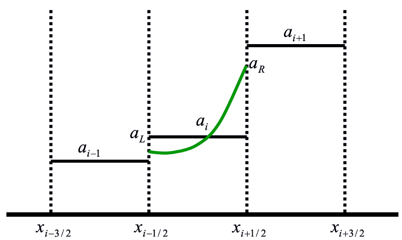

.. _PPM:

PPM Advection Scheme
====================

.. _section_PPM:

Advection Scheme
----------------

Following :cite:`colella1984` and :cite:`carpenter1990`, we use the Piecewise Parabolic Method (PPM) to represent values within the model cells. Each cell is assumed to have a piecewise parabolic representation, which is uniquely prescribed by conservation and the two edge values. This method has the following features:

- The PPM approach is conservative.

- The (unlimited) order of accuracy is determined by the estimates of the edge values.

- Monotonicity is ensured by adjusting the edge values to flatten the profile.

An example is shown in this figure:

   The parabolic representation of a field within a cell.

.. math::

   x'_i \equiv \frac{x - x_{i-1/2}} {\Delta x_i}

.. math::

   \Delta x_i \equiv x_{i + 1/2} - x_{i- 1/2}

.. math::

   c \equiv u \Delta t / \Delta x_i

.. math::

   A_i(x') = a_L + (a_R - a_L) x'_i + a_6 x'_i(1 - x'_i)

.. math::

   a_6 = 6a_i - 3 (a_R + a_L)

.. math::

   \begin{aligned}
   a_i &= \int_0^1 A_i(x'_i) dx'_i = \int_0^1 a_L + (a_R - a_L) x'_i + a_6 x'_i (1
      - x'_i) dx'_i \\
      &= \left[ a_L x'_i + \frac{1}{2} (a_R - a_L) x_i^{\prime 2} + a_6 \left( \frac{1}{2}
      x_i^{\prime 2} - \frac{1}{3} x_i^{\prime 3} \right) \right]_0^1 \\
      &= \frac{1}{2} (a_R + a_L) + \frac{1}{6} a_6
   \end{aligned}

.. math::

   \begin{aligned}
   F_{i+1/2} &= \frac{1}{\Delta t} \int_{x_{i + 1/2} - u \Delta t}^{x_{i + 1/2}}
      A_i^n(x) dx =
      \frac{\Delta x}{\Delta t} \int_{1-c}^1 A_i (x'_i) dx'_i \\
      &= \frac{\Delta x}{\Delta t} \left[ a_L x'_i + \frac{1}{2} (a_R - a_L)
      x_i^{\prime 2} + a_6 \left( \frac{1}{2} x_i^{\prime 2} -
      \frac{1}{3} x_i^{\prime 3} \right) \right]_{1 - c}^1 \\
      &= \frac{\Delta x}{\Delta t} \left[ a_L c + (a_R - a_L + a_6) \left( c -
      \frac{1}{2} c^2 \right) - a_6 \left( c - c^2 + \frac{1}{3} c^3 \right) \right] \\
      &= u \left[ a_R + \frac{1}{2} (a_L - a_R) c + a_6 \left( \frac{1}{2} c -
      \frac{1}{3} c^2 \right) \right]
   \end{aligned}

The choice of :math:`a_L` and :math:`a_R` is not unique, but can be done according to :cite:`colella1984` (CW84) or :cite:`huynh1997` (H3) as mentioned in `Tracer Advection <Tracer_Advection.html#tracer-advection>`__.
