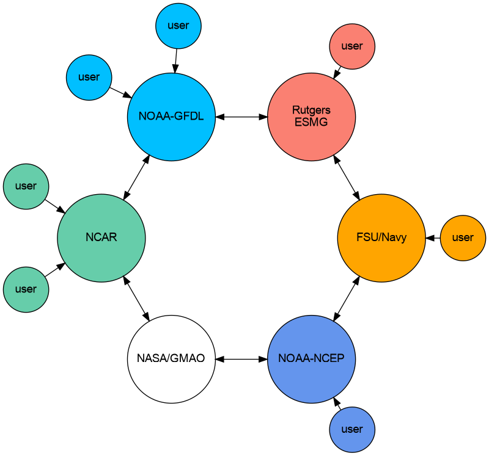
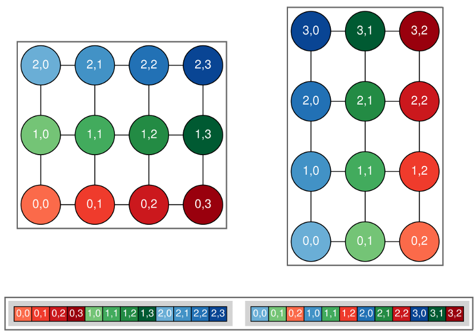
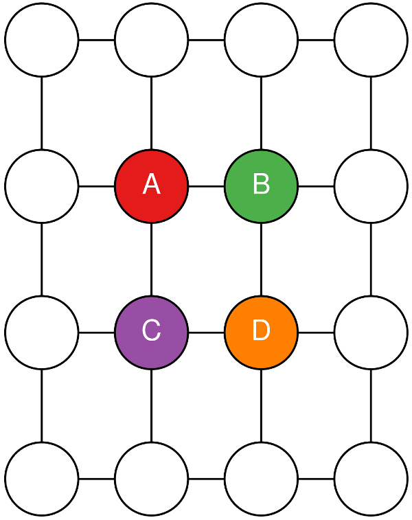
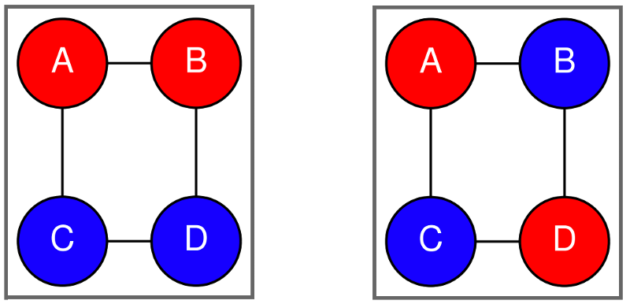

.. _Testing:

Testing
=======

MOM6 Validation and Verification

In the software engineering world, people talk about validation and verification of their codes. Verification is the confirmation of design specifications, such as:

- Does it compile on the target platform?

- Is it dimensionally consistent?

- Do answers change with the number of processes?

- Do answers change after a restart?

Validation is a little trickier:

- Does the model meet operational needs?

- Does it produce realistic simulations?

- Are relevant physical features present?

- Can I reproduce my old simulations?

There are a number of ways in which MOM6 is tested before each commit, especially commits to the shared dev/main branch.

.. _Travis:

Travis Testing
--------------

When pushing code to github, it is possible to set it up so that testing is performed automatically by travis. For MOM6, the .travis.yml file is executed, causing the code to be compiled and then run on all the tests in the .testing directory. It is also possible to run these tests on your local machine, but you might have to do some setup first. See See also: ../../../.testing/README.md for more information.

.. _Consortium_testing:

Consortium Testing
------------------

For commits to the dev/main branch, there is an opportunity for all consortium members to weigh in on proposed updates. A view of the consortium is shown here:

   The MOM6 consortium.

Each group is expected to have their own tests and to keep track of expected answers when these tests are run to be compared to prior answers after the code is updated. Answer-changing updates have to be evaluated carefully, though there are circumstances in which the new answers may well be “better”.

.. _Novel_tests:

Novel Tests
-----------

There are two classes of tests which MOM6 performs within the .testing suite which could be considered unusual, but which can be quite useful for finding bugs.

.. _Scalings:

Scaling tests
~~~~~~~~~~~~~

The equations of motion can be multiplied by factors of two without changing answers. One can use that to scale each of six units by a different factor of two to check for consistent use of units. For instance, the equation:

.. math::

   u^{n+1} = u^n + \Delta t \times \cal{F}

can be scaled as:

.. math::

   {2^{L-T}} u^{n+1} = {2^{L-T}} u^n + {2^T}
      \Delta t \times {2^{L-2T}} \cal{F}

MOM6 has been recoded to include six different scale factors:

.. list-table:: Dimensional scale factors
   :header-rows: 1

   * - Unit
     - Scaling
     - Name
   * - s
     - T
     - Time
   * - m
     - L
     - Horizontal length
   * - m
     - H
     - Layer thickness
   * - m
     - Z
     - Vertical length
   * - kg/m3
     - R
     - Density
   * - J/kg
     - Q
     - Enthalpy

You can add these integer scaling factors through the runtime parameters X_RESCALE_POWER, where X is one of T, L, H, Z, R, or Q. The valid range for these is -300 to 300.

When adding contributions to MOM6, this coding style with the scale factors must be maintained. For example, if you add new parameters to read from the input file:

.. code-block:: text

   call get_param(..., "DT", ... , scale=US%s_to_T)

This is also required for explicit contants, though we are trying to move those out of the code:

.. code-block:: text

   ustar = 0.01 * US%m_to_Z * US%T_to_s

or for adding diagnostics:

.. code-block:: text

   call register_diag_field(..., "u", ... , &
         conversion=US%L_T_to_m_s)

See also: :doc:`mom_unit_scaling`

.. _Rotations:

Rotational tests
~~~~~~~~~~~~~~~~

By setting the runtime option ROTATE_INDEX to True, the model rotates the domain by some number of 90 degree turns. This option can be used to look for bugs in which east-west operations do not match north-south operations. It changes the order of array elements as shown here:

   The original non-rotated domain is shown on the left while the right shows the domain rotated counterclockwise by 90 degrees. The array values are shown by the (invariant) colors, while the array indices (and dimensions) change.

It only currently runs in serial mode. One can ask for rotations of 90, 180, or 270 degrees, but only 90 degree turns are supported if there are open boundaries.

Because order matters in numerical computations, care must be taken for four-way averages to match between rotated and non-rotated runs. Say you want to compute the following quantity:

.. math::

   \phi_{i,j}^{(c)} = \frac{1}{4} (\phi_A + \phi_B + \phi_C + \phi_D)

as shown in this diagram:

   Four h points around a q point.

You might write this first as:

.. math::

   \frac{1}{4} ((\phi_A + \phi_B) + (\phi_C + \phi_D))

as shown on the left in this figure:

   Naive grouping of terms on the left, diagonal grouping of terms on the right.

However, the round-off errors could give differing answers when rotated. Instead, you want to group the terms on the diagonal as shown in the right of the above figure and here:

.. math::

   \frac{1}{4} ((\phi_A + \phi_D) + (\phi_B + \phi_C))
