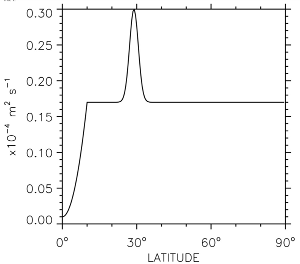

.. _Internal_Vert_Mixing:

Internal Vertical Mixing
========================

Sets the interior vertical diffusion of scalars due to the following processes:

1. Shear-driven mixing (`Shear-driven Mixing <Internal_Vert_Mixing.html#section-shear>`__): :cite:`jackson2008` or KPP interior;

2. Background mixing (`Background Mixing <Internal_Vert_Mixing.html#section-background>`__): via CVMix (Bryan-Lewis profile), the scheme described by :cite:`harrison2008`, or that in :cite:`danabasoglu2012`.

3. Double-diffusion (`Double Diffusion <Internal_Vert_Mixing.html#section-double-diff>`__): old method or new method via CVMix;

4. Tidal mixing: many options available, see `Internal Tidal Mixing <Internal_Vert_Mixing.html#section-internal-tidal-mixing>`__.

In addition, the MOM_set_diffusivity has the option to set the interior vertical viscosity associated with processes 1,2 and 4 listed above, which is stored in visc%Kv_slow. Vertical viscosity due to shear-driven mixing is passed via visc%Kv_shear

The resulting diffusivity, :math:`K_d`, is the sum of all the contributions unless you set BBL_MIXING_AS_MAX to True, in which case the maximum of all the contributions is used.

In addition, :math:`K_d` is multiplied by the term:

.. math::

   \frac{N^2}{N^2 + \Omega^2}

where :math:`N` is the buoyancy frequency and :math:`\Omega` is the angular velocity of the Earth. This allows the buoyancy fluxes to tend to zero in regions of very weak stratification, allowing a no-flux bottom boundary condition to be satisfied.

.. _section_Shear:

Shear-driven Mixing
-------------------

Below the surface mixed layer, there are places in the world’s oceans where shear mixing is known to take place. This shear-driven mixing can be represented in MOM6 through either CVMix or the parameterization of :cite:`jackson2008`.

.. _subsection_CVMix_shear:

Shear-driven mixing in CVMix
~~~~~~~~~~~~~~~~~~~~~~~~~~~~

The community vertical mixing (CVMix) code contains options for shear mixing from either :cite:`large1994` or from :cite:`pacanowski1981`. In MOM6, CVMix is included via a git submodule which loads the external CVMix package. The shear mixing routine in CVMix was developed to reproduce the observed mixing of the equatorial undercurrent in the Pacific.

We first compute the gradient Richardson number :math:`\mbox{Ri} = N^2 / S^2`, where :math:`S` is the vertical shear (:math:`S = ||\bf{u}_z ||`) and :math:`N` is the buoyancy frequency (:math:`N^2 = -g \rho_z / \rho_0`). The parameterization of :cite:`large1994` is as follows, where the diffusivity :math:`\kappa` is given by

.. math::

   \kappa = \kappa_0 \left[ 1 - \min \left( 1, \frac{\mbox{Ri}}{\mbox{Ri}_c} \right)
      ^2 \right] ^3 ,

with :math:`\kappa_0 = 5 \times 10^{-3}\, \mbox{m}^2 \,\mbox{s}^{-1}` and :math:`\mbox{Ri}_c = 0.7`.

One can instead select the :cite:`pacanowski1981` scheme within CVMix. Unlike the :cite:`large1994` scheme, they propose that the vertical shear viscosity :math:`\nu_{\mbox{shear}}` be different from the vertical shear diffusivity :math:`\kappa_{\mbox{shear}}`. For gravitationally stable profiles (i.e., :math:`N^2 > 0`), they chose

.. math::

   \nu_{\mbox{shear}} = \frac{\nu_0}{(1 + a \mbox{Ri})^n}

.. math::

   \kappa_{\mbox{shear}} = \frac{\nu_0}{(1 + a \mbox{Ri})^{n+1}}

where :math:`\nu_0`, :math:`a` and :math:`n` are adjustable parameters. Common settings are :math:`a = 5` and :math:`n = 2`.

For both CVMix shear mixing schemes, the mixing coefficients are set to a large value for gravitationally unstable profiles.

.. _subsection_kappa_shear:

Shear-driven mixing in Jackson
~~~~~~~~~~~~~~~~~~~~~~~~~~~~~~

While the above parameterization works well enough in the equatorial Pacific, another place one can expect shear-mixing to matter is in overflows of dense water. :cite:`jackson2008` proposes a new shear parameterization with the goal of working in both the equatorial undercurrent and for overflows, also to have smooth transitions between unstable and stable regions. Their scheme looks like:

.. _eq:Jackson_10:

.. math::

   \begin{aligned}
   \frac{\partial^2 \kappa}{\partial z^2} - \frac{\kappa}{L^2_d} &= - 2 SF(\mbox{Ri}) .
   \end{aligned}

This is similar to the locally constant stratification limit of :cite:`turner1986`, but with the addition of a decay length scale :math:`L_d = \lambda L_b`. Here :math:`L_b = Q^{1/2} / N` is the buoyancy length scale where :math:`Q` is the turbulent kinetic energy (TKE) per unit mass, and :math:`\lambda` is a nondimensional constant. The function :math:`F(\mbox{Ri})` is a function of the Richardson number that remains to be determined. As in :cite:`turner1986`, there must be a critical value of :math:`\mbox{Ri}` above which :math:`F(\mbox{Ri}) = 0`. For better agreement with observations in a law-of-the-wall configuration, we modify :math:`L_d` to be :math:`\min (\lambda L_b, L_z)`, where :math:`L_z` is the distance to the nearest solid boundary. This can be understood by considering :math:`L_d` to be the size of the largest turbulent eddies, whether they are constrained by the stratification (through :math:`L_b`) or through the geometry (through :math:`L_z`).

There are two length scales: the width of the low Richardson number region as in :cite:`turner1986`, and the buoyancy length scale, which is the length scale over which the TKE is affected by the stratification (see :cite:`jackson2008` for more details). In particular, the inclusion of a decay length scale means that the diffusivity decays exponentially away from the mixing region with a length scale of :math:`L_d`. This is important since turbulent eddies generated in the low :math:`\mbox{Ri}` layer can be vertically self-advected and mix nearby regions. This method yields a smoother diffusivity than that in :cite:`hallberg2000`, especially in areas where the Richardson number is noisy.

This parameterization predicts the turbulent eddy diffusivity in terms of the vertical profiles of velocity and density, providing that the TKE is known. To complete the parameterization we use a TKE :math:`Q` budget such as that used in second-order turbulence closure models (:cite:`umlauf2005`). We make a few additional assumptions, however, and use the simplified form

.. _eq:Jackson_11:

.. math::

   \begin{aligned}
   \frac{\partial}{\partial z} \left[ (\kappa + \nu_0) \frac{\partial Q}
      {\partial z} \right] + \kappa (S^2 - N^2) - Q(c_N N + c_S S) &= 0.
   \end{aligned}

The system is therefore in balance between a vertical diffusion of TKE caused by both the eddy and molecular viscosity :math:`(\nu_0)`, the production of TKE by shear, a sink due to stratification, and the dissipation. Note that we are assuming a Prandtl number of 1, although a parameterization for the Prandtl number could be added. We have assumed that the TKE reaches a quasi-steady state faster than the flow is evolving and faster than it can be affected by mean-flow advection so that :math:`DQ/Dt = 0`. Since this parameterization is meant to be used in climate models with low horizontal resolution and large time steps compared to the mixing time scales, this is a reasonable assumption. The most tenuous assumption is in the form of the dissipation :math:`\epsilon = Q(C_N N + c_S S)` (where :math:`c_N` and :math:`c_S` are to be determined), which is assumed to be dependent on the buoyancy frequency (through loss of energy to internal waves) and the velocity shear (through the energy cascade to smaller scales).

We can rewrite `Jackson et al. equation (10) <Internal_Vert_Mixing.html#eq-jackson-10>`__ as the steady “transport” equation for the turbulent diffusivity (i.e., with :math:`D\kappa/Dt = 0`),

.. math::

   \frac{\partial}{\partial z} \left( \kappa \frac{\partial \kappa}{\partial z}
     \right) + 2\kappa SF(\mbox{Ri}) - \left( \frac{\kappa}{L_d} \right)^2 -
     \left( \frac{\partial \kappa}{\partial z} \right) ^2 = 0 .

The first term on the left can be regarded as a vertical transport of diffusivity, the second term as a source, and the final two as sinks. This equation with `Jackson et al. equation (11) <Internal_Vert_Mixing.html#eq-jackson-11>`__ are simple enough to solve quickly using an iterative technique.

We also need boundary conditions for `Jackson et al. equation (10) <Internal_Vert_Mixing.html#eq-jackson-10>`__ and `Jackson et al. equation (11) <Internal_Vert_Mixing.html#eq-jackson-11>`__. For the turbulent diffusivity we use :math:`\kappa = 0` since our diffusivity is numerically defined on layer interfaces. This ensures that there is no turbulent flux across boundaries. For the TKE we use boundary conditions of :math:`Q = Q_0` where :math:`Q_0` is a constant value of TKE, used to prevent a singularity in `Jackson et al. equation (10) <Internal_Vert_Mixing.html#eq-jackson-10>`__, that is chosen to be small enough to not influence results. Note that the value of :math:`\kappa` calculated here reflects shear-driven turbulent mixing only; the total diffusivity would be this value plus any diffusivities due to other turbulent processes or a background value.

Based on :cite:`turner1986`, we choose :math:`F(\mbox{Ri})` of the form

.. math::

   F(\mbox{Ri}) = F_0 \left( \frac{1 - \mbox{Ri} / \mbox{Ri}_c}
      {1 + \alpha \mbox{Ri} / \mbox{Ri}_c} \right) ,

where :math:`\alpha` is the curvature parameter. This table shows the default values of the relevant parameters:

.. list-table:: Shear mixing parameters
   :header-rows: 1

   * - Parameter
     - Default value
     - MOM6 parameter
   * - :math:`\mbox{Ri}_c`
     - 0.25
     - RINO_CRIT
   * - :math:`\nu_0`
     - :math:`1.5 \times 10^{-5}`
     - KD_KAPPA_SHEAR_0
   * - :math:`F_0`
     - 0.089
     - SHEARMIX_RATE
   * - :math:`\alpha`
     - -0.97
     - FRI_CURVATURE
   * - :math:`\lambda`
     - 0.82
     - KAPPA_BUOY_SCALE_COEF
   * - :math:`c_N`
     - 0.24
     - TKE_N_DECAY_CONST
   * - :math:`c_S`
     - 0.14
     - TKE_SHEAR_DECAY_CONST

These can all be adjusted at run time, plus some other parameters such as the maximum number of iterations to perform.

.. _section_Background:

Background Mixing
-----------------

There are three choices for the vertical background mixing: that in CVMix (:cite:`bryan1979`), that in :cite:`harrison2008`, and that in :cite:`danabasoglu2012`.

.. _subsection_bryan_lewis:

CVMix background mixing
~~~~~~~~~~~~~~~~~~~~~~~

The background vertical mixing in :cite:`bryan1979` is of the form:

.. math::

   \kappa = C_1 + C_2 \mbox{atan} [ C_3 ( |z| - C_4 )]

where the constants are runtime parameters as shown here:

.. list-table:: Bryan Lewis parameters
   :header-rows: 1

   * - Parameter
     - Units
     - MOM6 parameter
   * - :math:`C_1`
     - m2 s-1
     - BRYAN_LEWIS_C1
   * - :math:`C_2`
     - m2 s-1
     - BRYAN_LEWIS_C2
   * - :math:`C_3`
     - m-1
     - BRYAN_LEWIS_C3
   * - :math:`C_4`
     - m
     - BRYAN_LEWIS_C4

.. _subsection_henyey:

Henyey IGW background mixing
~~~~~~~~~~~~~~~~~~~~~~~~~~~~

:cite:`harrison2008` choose a vertical background mixing with a latitudinal dependence based on :cite:`henyey1986`. Specifically, theory predicts a minimum in mixing due to wave-wave interactions at the equator and observations support that theory. In this option, the surface background diffusivity is

.. math::

   \kappa_s (\phi) = \max \left[ 10^{-7}, \kappa_0 \left| \frac{f}{f_{30}} \right|
      \frac{ \cosh^{-1} (1/f) }{ \cosh^{-1} (1/f_{30})} \right] ,

where :math:`f_{30}` is the Coriolis frequency at :math:`30^\circ` latitude. The two-dimensional equation for the diffusivity is

.. math::

   \kappa(\phi, z) = \kappa_s + \Gamma \mbox{atan} \left( \frac{H_t}{\delta_t} \right) +
      \Gamma \mbox{atan} \left( \frac{z - H_t}{\delta_t} \right) ,

.. math::

   \Gamma = \frac{(\kappa_d - \kappa_s) }{\left[ 0.5 \pi + \mbox{atan} \left( \frac{H_t}{\delta_t} \right)
      \right] },

where :math:`H_t = 2500\, \mbox{m}`, :math:`\delta_t = 222\, \mbox{m}`, and :math:`\kappa_d` is the deep ocean diffusivity of :math:`10^{-4}\, \mbox{m}^2 \, \mbox{s}^{-1}`. Note that this is the vertical structure described in :cite:`harrison2008`, but that isn’t what is in the MOM6 code. Instead, the surface value is propagated down, with the assumption that the tidal mixing parameterization will provide the deep mixing: `Internal Tidal Mixing <Internal_Vert_Mixing.html#section-internal-tidal-mixing>`__.

.. _subsection_danabasoglu_back:

Danabasoglu background mixing
~~~~~~~~~~~~~~~~~~~~~~~~~~~~~

The shape of the :cite:`danabasoglu2012` background mixing has a uniform background value, with a dip at the equator and a bump at :math:`\pm 30^{\circ}` degrees latitude. The form is shown in this figure

   Form of the vertically uniform background mixing in Danabasoglu [2012]. The values are symmetric about the equator.

Some parameters of this curve are set in the input file, some are hard-coded in calculate_bkgnd_mixing.

.. _section_Double_Diff:

Double Diffusion
----------------

From :cite:`large1994`, :cite:`griffies2015a`, double-diffusive mixing can occur when the vertical gradient of density is stable but the vertical gradient of either salinity or temperature is unstable in its contribution to density. The key stratification parameter for double diffusive processes is

.. math::

   R_\rho = \frac{\alpha}{\beta} \left( \frac{\partial \Theta / \partial z}{\partial S /
      \partial z} \right) ,

where the thermal expansion coefficient is given by

.. math::

   \alpha = - \frac{1}{\rho} \left( \frac{\partial \rho}{\partial \Theta} \right) ,

and the haline contraction coefficient is

.. math::

   \beta = \frac{1}{\rho} \left( \frac{\partial \rho}{\partial S} \right) .

Note that the effects from double diffusive processes on viscosity are not well known and are ignored in MOM6.

In MOM6, there are two choices for the implementation of double diffusion. The older DOUBLE_DIFFUSION option, with reference to an unknown tech report from NCAR, aims to match the scheme used in MOM4, an update on :cite:`large1994`. The newer option is to call the routines from CVMix (USE_CVMIX_DDIFF).

There are two regimes of double diffusive processes, salt fingering and diffusive convective, with differing parameterizations in the two regimes.

.. _subsection_salt_finger:

Salt fingering regime
~~~~~~~~~~~~~~~~~~~~~

The salt fingering regime occurs when salinity is destabilizing the water column (salty, above fresh water) and when the stratification parameter :math:`R_\rho` is within a particular range:

.. math::

   \frac{\partial S}{\partial z} > 0

.. math::

   1 < R_\rho < R_\rho^0.

The value of the cutoff :math:`R_\rho` is 1.9 in the old code, 2.55 in CVMix.

The form of the diffusivity for both is

.. math::

   \begin{aligned}
      \kappa_d =& \kappa_d^0 \left[ 1 - \left( \frac{R_\rho - 1}{R_\rho^0 - 1} \right)
      \right]^3 & \mbox{for } 1 < R_\rho < R_\rho^0 \\
      \kappa_d =& 0 & \mbox{otherwise.}
   \end{aligned}

The default values of :math:`\kappa_d^0` are

.. math::

   \begin{aligned}
      \kappa_d^0 =& 1 \times 10^{-4} & \mbox{for salinity and other tracers} \\
      \kappa_d^0 =& 0.7 \times 10^{-4} & \mbox{for temperature.}
   \end{aligned}

Note that the form in :cite:`large1994` is slightly different.

.. _subsection_diffusive_convective:

Diffusive convective regime
~~~~~~~~~~~~~~~~~~~~~~~~~~~

Both implementations of the diffusive convective double diffusion have the same form (:cite:`large1994`) and are active when

.. math::

   \frac{\partial \Theta}{\partial z} < 0

.. math::

   0 < R_\rho < 1.

For temperature, the vertical diffusivity is given by

.. math::

   \kappa_d = \nu_\mbox{molecular} \times 0.909 \exp \left( 4.6 \exp \left[ -.54
      \left( R_\rho^{-1} - 1 \right) \right] \right) ,

where

.. math::

   \nu_\mbox{molecular} = 1.5 \times 10^{-6} \mbox{m}^2 \mbox{s}^{-1}

is the molecular viscosity of water. Multiplying the diffusivity by the Prandtl number :math:`Pr`

.. math::

   \begin{aligned}
      Pr = \left\{ \begin{matrix} (1.85 - 0.85 R_\rho^{-1} ) R_\rho & 0.5 \leq R_\rho < 1 \\
      0.15 R_\rho & R_\rho < 0.5 , \end{matrix} \right.
   \end{aligned}

gives the diffusivity for salinity and other tracers.

.. _section_Internal_Tidal_Mixing:

Internal Tidal Mixing
---------------------

Two parameterizations of vertical mixing due to internal tides are available with the option INT_TIDE_DISSIPATION. The first is that of :cite:`st_laurent2002` while the second is that of :cite:`polzin2009`. Choose between them with the INT_TIDE_PROFILE option. There are other relevant parameters which can be seen in MOM_parameter_doc.all once the main tidal dissipation switch is turned on.

.. _subsection_st_laurent:

St Laurent et al.
~~~~~~~~~~~~~~~~~

The estimated turbulent dissipation rate of internal tide energy :math:`\epsilon` is:

.. math::

   \epsilon = \frac{q E(x,y)}{\rho} F(z).

where :math:`\rho` is the reference density of seawater, :math:`E(x,y)` is the energy flux per unit area transferred from barotropic to baroclinic tides, :math:`q` is the fraction of the internal-tide energy dissipated locally, and :math:`F(z)` is the vertical structure of the dissipation. This :math:`q` is estimated to be roughly 0.3 based on observations. The term :math:`E(x,y)` is given by :cite:`st_laurent2002` as:

.. math::

   E(x,y) \simeq \frac{1}{2} \rho N_b \kappa h^2 \langle U^2 \rangle

where :math:`\rho` is the reference density of seawater, :math:`N_b` is the buoyancy frequency along the seafloor, and :math:`(\kappa, h)` are the wavenumber and amplitude scales for the topographic roughness, and :math:`\langle U^2 \rangle` is the barotropic tide variance. It is assumed that the model will read in topographic roughness squared :math:`h^2` from a file (the variable must be named “h2”).

To convert from energy dissipation to vertical diffusion :math:`K_d`, the simple estimate is:

.. math::

   K_d \approx \frac{\Gamma q E(x,y) F(z)}{\rho N^2}

where :math:`\Gamma` is the mixing efficiency, generally set to 0.2 and :math:`F(z)` is a vertical structure function with exponential decay from the bottom:

.. math::

   F(z) = \frac{e^{-(H+z)/\zeta}}{\zeta (1 - e^{H/\zeta}}.

Here, :math:`\zeta` is a vertical decay scale with a default of 500 meters. One change in MOM6 from the St. Laurent scheme is to use this form of :math:`\Gamma`:

.. math::

   \Gamma = 0.2 \frac{N^2}{N^2 + \Omega^2}

instead of :math:`\Gamma = 0.2`, where :math:`\Omega` is the angular velocity of the Earth. This allows the buoyancy fluxes to tend to zero in regions of very weak stratification, allowing a no-flux bottom boundary condition to be satisfied.

.. _subsection_polzin:

Polzin
~~~~~~

The vertical diffusion profile of :cite:`polzin2009` is a WKB-stretched algebraic decay profile. It is based on a radiation balance equation, which links the dissipation profile associated with internal breaking to the finescale internal wave shear producing that dissipation. The vertical profile of internal-tide driven energy dissipation can then vary in time and space, and evolve in a changing climate (:cite:`melet2012`). :cite:`melet2012` describes how the Polzin scheme is implemented in MOM6, copied here.

The parameterization of :cite:`polzin2009` links the energy dissipation profile to the finescale internal wave shear producing that dissipation, using an idealized vertical wavenumber energy spectrum to identify analytic solutions to a radiation balance equation (:cite:`polzin2004`). These solutions yield a dissipation profile :math:`\epsilon(z)`:

.. math::

   \epsilon = \frac{\epsilon_0}{[1 + (z/z_p)]^2},

where the magnitude :math:`\epsilon_0` and scale height :math:`z_p` can be expressed in terms of the spectral amplitude and bandwidth of the idealized vertical wavenumber energy spectrum in uniform stratification (:cite:`polzin2009`).

To take into account the nonuniform stratification, :cite:`polzin2009` applied a buoyancy scaling using the Wentzel-Kramers-Brillouin (WKB) approximation. As a result, the vertical wavenumber of a wave packet varies in proportion to the buoyancy frequency :math:`N`, which in turn implies an additional transport of energy to smaller scales, and thus a possible enhanced mixing in regions of strong stratification. Such effects can be described by buoyancy scaling the vertical coordinate :math:`z` as

.. math::

   z^{\ast}(z) = \int_{0}^{z} \left[ \frac{N^2 (z^\prime )}{N_b^2} \right] dz^{\prime} ,

with :math:`z^\prime` being positive upward relative to the bottom of the ocean. The turbulent dissipation rate then becomes

.. math::

   \epsilon = \frac{\epsilon_0}{[1 + (z^{\ast} /z_p)]^2} \frac{N^2(z)}{N_b^2} .

The spectral amplitude and bandwidth of the idealized vertical wavenumber energy spectrum are identified after WKB scaling using a quasi-linear spectral model of internal-tide generation that incorporates horizontal advection of the barotropic tide into the momentum equation (:cite:`bell1975`). As a result, Polzin’s formulation leads to an expression for the spatially and temporally varying dissipation of internal tide energy at the bottom :math:`\epsilon_0`, and the vertical scale of decay for the dissipation of internal tide energy :math:`z_p`.

.. _subsection_energy_conserving:

Energy-conserving form
^^^^^^^^^^^^^^^^^^^^^^

To satisfy energy conservation (the integral of the vertical structure for the turbulent dissipation over depth should be unity), the dissipation is rewritten as

.. math::

   \epsilon = \frac{\epsilon_0 z_p}{1 + (z^\ast/z_p)]^2} \frac{N^2(z)}{N^2_b} \left[
      \frac{1}{z^{\ast(z=H)}} + \frac{1}{z_p} \right] .

In the MOM6 implementation, we use the :cite:`st_laurent2002` template for the vertical flux of energy at the ocean floor, so that in both formulations:

.. math::

   \int_{0}^{H} \epsilon (z) dz = \frac{qE}{\rho} .

Whereas :cite:`polzin2009` assumed that the total dissipation was locally in balance with the barotropic to baroclinic energy conversion rate :math:`(q=1)`, here we use the :cite:`simmons2004` value of :math:`q=1/3` to retain as much consistency as possible between both parameterizations.

.. _subsection_vertical_decay_scale:

Vertical decay-scale reformulation
^^^^^^^^^^^^^^^^^^^^^^^^^^^^^^^^^^

We follow the :cite:`polzin2009` prescription for the vertical scale of decay for the dissipation of internal-tide energy. However, we assume that the topographic power law, denoted as :math:`\nu` in :cite:`polzin2009`, is equal to 1 (instead of 0.9) and we reformulated the expression of :math:`z_p` to put it in a more readable form:

.. math::

   z_p = \frac{z_p^\mbox{ref} (\kappa^\mbox{ref})^2 (h^\mbox{ref})^2 (N_b^\mbox{ref})^3} {U^\mbox{ref}}
      \frac{U}{h^2 \kappa^2 N_b^3} .

The superscript ref refers to reference values of the various parameters, as given by observations from the Brazil basin. Therefore, the above can be rewritten as

.. math::

   z_p = \mu (N_b^\mbox{ref} )^2
      \frac{U}{h^2 \kappa^2 N_b^3} .

where :math:`\mu` is a nondimensional constant :math:`(\mu = 0.06970)` and :math:`N_b^\mbox{ref} = 9.6 \times 10^{-4} s^{-1}`. Finally, a minimum decay scale of :math:`z_p = 100 m` is imposed in our implementation.

.. _subsection_reformulation_WKB:

Reformulation of the WKB scaling
^^^^^^^^^^^^^^^^^^^^^^^^^^^^^^^^

Since the dissipation is expressed as a function of the ratio :math:`z^\ast / z_p`, a different WKB scaling can be used so long as we modify :math:`z_p` accordingly. In the implemented parameterization, we define the scaled height coordinate :math:`z^\ast` by

.. math::

   z^\ast (z) = \frac{1}{\overline{N^2 (z)}^z} \int_{0}^{z} N^2(z^\prime ) dz ^\prime ,

with :math:`z^\prime` defined to be the height above the ocean bottom. By normalizing :math:`N^2` by its vertical mean :math:`\overline{N^2}^z`, :math:`z^\ast` ranges from :math:`0` to :math:`H`, the depth of the ocean.

The WKB-scaled vertical decay scale for the Polzin formulation becomes

.. math::

   z^\ast_p = \mu(N_b^\mbox{ref})^2 \frac{U}{h^2 \kappa^2 N_b \overline{N^2}^z} .

Unlike the :cite:`st_laurent2002` parameterization, the vertical decay scale now depends on physical variables and can evolve with a changing climate.

Finally, the Polzin vertical profile of dissipation implemented in the model is given by

.. math::

   \epsilon = \frac{qE(x,y)}{\rho [1 + (z^\ast/z_p^\ast)]^2} \frac{N^2(z)}{\overline{N^2}^z}
      \left( \frac{1}{H} + \frac{1}{z_p^\ast} \right) .

In both parameterizations, turbulent diapycnal diffusivities are inferred from the dissipation :math:`\epsilon` by:

.. math::

   K_d = \frac{\Gamma \epsilon}{N^2}

and using this form of :math:`\Gamma`:

.. math::

   \Gamma = 0.2 \frac{N^2}{N^2 + \Omega^2}

instead of :math:`\Gamma = 0.2`, where :math:`\Omega` is the angular velocity of the Earth. This allows the buoyancy fluxes to tend to zero in regions of very weak stratification, allowing a no-flux bottom boundary condition to be satisfied.

.. _subsection_Lee_waves:

Nikurashin Lee Wave Mixing
~~~~~~~~~~~~~~~~~~~~~~~~~~

If one has the INT_TIDE_DISSIPATION flag on, there is an option to also turn on LEE_WAVE_DISSIPATION. The theory is presented in :cite:`nikurashin2010a` while the application of it is presented in :cite:`nikurashin2010b`. For the implementation in MOM6, it is required that you provide an estimate of the TKE loss due to the Lee waves which is then applied with either the St. Laurent or the Polzin vertical profile.

TODO: Is there a script to produce this somewhere or what???
