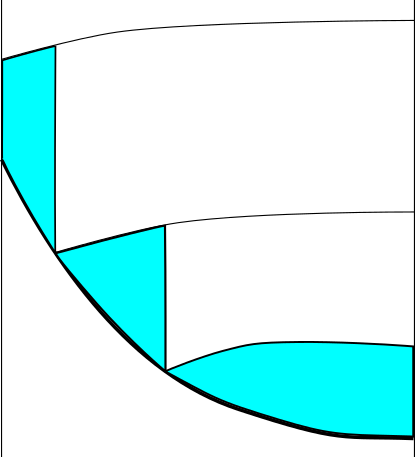

.. _Vertical_Viscosity:

Vertical Viscosity
==================

The vertical viscosity is composed of several components.

1. The vertical diffusivity computations for the background and shear mixing all save contributions to the viscosity with an assumed turbulent Prandtl number of 1.0, though this can be changed with the PRANDTL_BKGND and PRANDTL_TURB parameters, respectively.

2. If the ePBL scheme is used, it contributes to the vertical viscosity with a Prandtl number of PRANDTL_EPBL.

3. If the CVMix scheme is used, it contributes to the vertical viscosity with a Prandtl number of PRANDTL_CONV.

4. If the tidal mixing scheme is used, it contributes to the vertical viscosity with a Prandtl number of PRANDTL_TIDAL.

.. _set_viscous_BBL:

Viscous Bottom Boundary Layer
-----------------------------

A drag law is used, either linearized about an assumed bottom velocity or using the actual near-bottom velocities combined with an assumed unresolved velocity. The bottom boundary layer thickness is limited by a combination of stratification and rotation, as in the paper of :cite:`killworth1999`. It is not necessary to calculate the thickness and viscosity every time step; instead previous values may be used.

If set_visc_CS%bottomdraglaw is True then a bottom boundary layer viscosity and thickness are calculated so that the bottom stress is

.. math::

   \mathbf{\tau}_b = C_d | U_{bbl} | \mathbf{u}_{bbl}

If set_visc_CS%bottomdraglaw is True then the term :math:`|U_{bbl}|` is set equal to the value in set_visc_CS.drag_bg_vel so that :math:`C_d |U_{bbl}|` becomes a Rayleigh bottom drag. Otherwise :math:`|U_{bbl}|` is found by averaging the flow over the bottom set_visc_CS%hbbl of the model, adding the amplitude of tides set_visc_CS%tideamp and a constant set_visc_CS%drag_bg_vel. For these calculations the vertical grid at the velocity component locations is found by

.. math::

   \begin{aligned}
   \begin{array}{ll}
   \frac{2 h^- h^+}{h^- + h^+} & u \left( h^+ - h^-\right) >= 0
   \\
   \frac{1}{2} \left( h^- + h^+ \right) &  u \left( h^+ - h^-\right) < 0
   \end{array}
   \end{aligned}

which biases towards the thin cell if the thin cell is upwind. Biasing the grid toward thin upwind cells helps increase the effect of viscosity and inhibits flow out of these thin cells.

After diagnosing :math:`|U_{bbl}|` over a fixed depth an active viscous boundary layer thickness is found using the ideas of :cite:`killworth1999` (hereafter KW99). KW99 solve the equation

.. math::

   \left( \frac{h_{bbl}}{h_f} \right)^2 + \frac{h_{bbl}}{h_N} = 1

for the boundary layer depth :math:`h_{bbl}`. Here

.. math::

   h_f = \frac{C_n u_*}{f}

is the rotation controlled boundary layer depth in the absence of stratification. :math:`u_*` is the surface friction speed given by

.. math::

   u_*^2 = C_d |U_{bbl}|^2

and is a function of near bottom model flow.

.. math::

   h_N = \frac{C_i u_*}{N} = \frac{ (C_i u_* )^2 }{g^\prime}

is the stratification controlled boundary layer depth. The non-dimensional parameters :math:`C_n=0.5` and :math:`C_i=20` are suggested by :cite:`zilitinkevich1996`.

If a Richardson number dependent mixing scheme is being used, as indicated by set_visc_CS%rino_mix, then the boundary layer thickness is bounded to be no larger than a half of set_visc_CS%hbbl .

A BBL viscosity is calculated so that the no-slip boundary condition in the vertical viscosity solver implies the stress :math:`\mathbf{\tau}_b`:

.. math::

   K_{bbl} = \frac{1}{2} h_{bbl} \sqrt{C_{drag}} \, u^\ast

.. _section_Channel_drag:

Channel Drag
------------

The channel drag is an extra Rayleigh drag applied to those layers within the bottom boundary layer. It is called channel drag because it accounts for curvature of the bottom, applying the drag proportionally to how much of each cell is within the bottom boundary layer. The bottom shape is approximated as locally parabolic. The bottom drag is applied to each layer with a factor :math:`R_k`, the sum of which is 1 over all the layers.

   Example of layers intersecting a sloping bottom, with the blue showing the fraction of the cell over which bottom drag is applied.

The velocity that is actually subject to the bottom drag may be substantially lower than the mean layer velocity, especially if only a small fraction of the layer’s width is subject to the bottom drag.

The code begins by finding the arithmetic mean of the water depths to find the depth at the velocity points. It then uses these to construct a parabolic bottom shape, valid for :math:`I - \frac{1}{2}` to :math:`I + \frac{1}{2}`. The parabola is:

.. math::

   D(x) = a x^2 + b x + D - \frac{a}{12}

For sufficiently small curvature :math:`a`, one can drop the quadratic term and assume a linear function instead. We want a form that matches the traditional bottom drag when the bottom is flat.

We defined the open fraction of each cell as :math:`l(k) \equiv L(k)/L_{Tot}`, where terms of order :math:`l^2` will be dropped.

Hallberg (personal communication) shows how they came up with the form used in the code, in which the :math:`R_k` above are set to:

.. math::

   R_k = \gamma_k l_{k-1/2} \left[ \frac{12 c_{Smag} h_k}{12 c_{Smag} k_k + c_d \gamma_k (1 - \gamma_k)
      (1 - \frac{3}{2} \gamma_k) l^2_{k-1/2} L_{Tot}} \right]

with the definition :math:`\gamma_k \equiv (l_{k-1/2} - l_{k+1/2})/l_{k-1/2}`. This ensures that :math:`\sum^N_{k=1} \gamma_k l_{k-1/2} = 1` since :math:`l_{1/2} = 1` and :math:`l_{N+1/2} = 0`.
