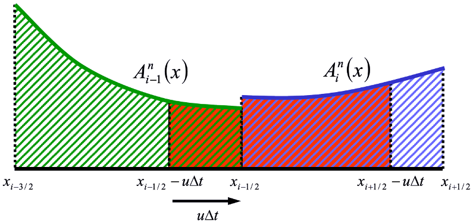

.. _Tracer_Transport_Equations:

Tracer Transport Equations
==========================

   The 1-D finite volume advection of tracers. The reddish fluid will be in the cell at the end of the timestep.

Given a piecewise polynomial description of the tracer concentration, the new tracer cell concentration is the average of the fluid that will be in the cell after a timestep.

.. math::

   \begin{aligned}
   \int_{x_{i-1/2}}^{x_{i+1/2}} A_i^{n+1} (x) dx =
     \int_{x_{i-1/2 - u \Delta t}}^{x_{i+1/2-u\Delta t}} A_i^{n} (x) dx &= \mbox{} \\
     \int_{x_{i-1/2}}^{x_{i+1/2}} A_i^{n} (x) dx -
     \int_{x_{i+1/2 - u \Delta t}}^{x_{i+1/2}} A_i^{n} (x) dx &+
     \int_{x_{i-1/2 - u \Delta t}}^{x_{i-1/2}} A_i^{n} (x) dx
   \end{aligned}

Fluxes are found by analytically integrating the profile over the distance that is swept past the face within a timestep.

.. math::

   a_i^n = \frac{1}{\Delta x} \int_{x_{i-1/2}}^{x_{i+1/2}} A_i^n(x) dx

.. math::

   a_i^{n+1} = a_i^n - \frac{\Delta t}{\Delta x} (F_{i+1/2} - F_{i-1/2})

.. math::

   F_{i+1/2} = \frac{1}{\Delta t} \int_{x_{i+1/2 - u \Delta t}}^{x_{i+1/2}} A_i^n(x) dx

.. math::

   F_{i-1/2} = \frac{1}{\Delta t} \int_{x_{i-1/2 - u \Delta t}}^{x_{i-1/2}} A_i^n(x) dx

With piecewise constant profiles, this approach give first order upwind advection. Higher order polynomials (e.g., parabolas) can give higher order accuracy.

.. _Multidimensional_Tracer_Advection:

Multidimensional Tracer Advection
---------------------------------

Using “Easter’s Pseudo-compressibility” (:cite:`easter1993`), we start with these basic equations for a tracer :math:`\psi`:

.. _ht-equation:

.. math::

   \frac{\partial h}{\partial t} + \vec{\nabla} \cdot (\vec{u}h) = 0 \equiv
      \frac{\partial h}{\partial t} + \vec{\nabla} \cdot (\vec{U})

.. math::

   \frac{\partial}{\partial t} (h \psi) + \vec{\nabla} \cdot (\vec{U}\psi) = 0

.. math::

   \frac{\partial \psi}{\partial t} + \vec{u} \cdot \vec{\nabla} \psi = 0

We discretize the first of these equations in space:

.. math::

   \frac{\partial h}{\partial t} = \frac{1}{\Delta x} \left(U_{i-\frac{1}{2},j} -
      U_{i+\frac{1}{2},j} \right) + \frac{1}{\Delta y} \left(V_{i, j-\frac{1}{2}} -
      V_{i,j+\frac{1}{2}} \right)

Using our monotonic one-dimensional flux:

.. math::

   F_{i+\frac{1}{2},j} (\psi) = U_{i+\frac{1}{2},j} \psi_{i+\frac{1}{2},j}

we come up with an estimate based only on an update in the :math:`x` direction:

.. math::

   \tilde{h}_{i,j} \tilde{\psi}_{i,j} = h^n_{i,j} \psi_{i,j} + \frac{\Delta
      t}{\Delta x} \left( F_{i-\frac{1}{2},j} (\psi^n) - F_{i+\frac{1}{2},j} (\psi^n)
      \right)

.. math::

   \tilde{h}_{i,j} = h^n_{i,j} + \frac{\Delta
      t}{\Delta x} \left( U_{i-\frac{1}{2},j} - U_{i+\frac{1}{2},j} \right)

.. math::

   \tilde{\psi}_{i,j} = \frac{\tilde{h}_{i,j} \tilde{\psi}_{i,j}}{\tilde{h}_{i,j}}

Next, we update in the :math:`y` direction:

.. math::

   h^{n+1}_{i,j} \psi^{n+1}_{i,j} = \tilde{h}_{i,j} \tilde{\psi}_{i,j} + \frac{\Delta
      t}{\Delta y} \left( G_{i,j-\frac{1}{2}} (\tilde{\psi}) - G_{i,j+\frac{1}{2}}
      (\tilde{\psi}) \right)

.. math::

   h^{n+1}_{i,j} = \tilde{h}_{i,j} + \frac{\Delta
      t}{\Delta y} \left( V_{i,j-\frac{1}{2}} - V_{i,j+\frac{1}{2}} \right)

.. math::

   \psi^{n+1}_{i,j} = \frac{h^{n+1}_{i,j} \psi^{n+1}_{i,j}}{h^{n+1}_{i,j}}

- This method ensures monotonicity. Strang splitting can reduce directional splitting error. See :cite:`easter1993`, :cite:`durran2010` (section 5.9.4), and :cite:`russell1981` .

- Flux-form pseudo-compressibility advection is based on accumulated mass (or volume) fluxes, not velocities.

- Additional pseudo-compressibility passes can be added to accommodate transports exceeding cell masses. Extra passes of tracer advection are used in MOM6 in the small fraction of cells where this is needed.

- Explicit layered dynamics time-steps are limited by Doppler-shifted internal gravity wave speeds or inertial oscillations. Flow speeds in most of the ocean volume are much smaller than the peak internal wave speeds so that the advective time-steps can be longer.

- Advective mass fluxes in MOM6 are often accumulated over multiple dynamic steps. The goal is that as we go to higher resolution, this tracer advection will remain stable at relatively long time-steps, allowing for the inclusion of many biogeochemical tracers without adding an undue burden in computational cost.
